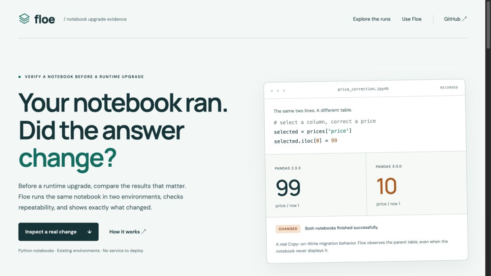

# Floe

### Your notebook ran. Did the answer change?

Compare selected Python notebook results before a runtime upgrade, then reduce a stable change to a smaller reproducer.

[**Live demo →**](https://balkashynov.github.io/floe/) · [Quickstart](#run-the-example) · [Engineering](ENGINEERING.md) · [Validation](VALIDATION.md)

[](https://balkashynov.github.io/floe/)

## A successful run can still change the result

A notebook selects a price column and changes its first value. It finishes in both environments and prints the same message. In pandas 2.3.3 the parent table changes; in pandas 3.0.0 it does not.

| Selected observation | pandas 2.3.3 | pandas 3.0.0 |
| --- | --- | --- |
| Original assignment | Price is **99** | Price is **10** |
| Repaired assignment | Price is **99** | Price is **99** |

[Inspect the original](https://balkashynov.github.io/floe/#case=copy-on-write) and [its repaired control](https://balkashynov.github.io/floe/#case=copy-fixed). The demo displays saved real executions and runs entirely in the browser. No installation or sign-in is needed.

## What Floe does

1. **Observe a result.** Name a notebook cell and variable. Declare table identity, numerical tolerances and schema policy.
2. **Compare two environments.** Execute in fresh kernels, check variation within each environment, then compare every reference/candidate pair.
3. **Keep the evidence.** Save typed values, source/input fingerprints, environments and an HTML report. Reduce a stable difference while preserving both observed values.

Floe is useful for selected in-memory results that are not already covered by assertions or displayed-output tests. For a known invariant, an assertion may be simpler. For notebook output regression tests, consider [nbval](https://nbval.readthedocs.io/en/latest/) or [pytest-notebook](https://pytest-notebook.readthedocs.io/en/latest/).

## Run the example

Requires Python 3.12 and [uv](https://docs.astral.sh/uv/). Run trusted notebooks only.

```sh
git clone https://github.com/balkashynov/floe.git
cd floe
uv venv --python 3.12 .venv
uv pip sync --python .venv/bin/python examples/reference-requirements.txt
uv venv --python 3.12 .runtimes/pandas3
uv pip sync --python .runtimes/pandas3/bin/python examples/candidate-requirements.txt
uv pip install --python .venv/bin/python --no-deps .

.venv/bin/floe run examples/copy-on-write.ipynb \
  --contract examples/copy-on-write.json \
  --reference .venv/bin/python \
  --candidate .runtimes/pandas3/bin/python \
  --output comparison
```

The expected verdict is **`changed`**, with exit code **1**. Open `comparison/report.html`. Run `copy-fixed.ipynb` with `copy-fixed.json` into a new output directory for a **`match`** control. Existing output directories are refused to preserve evidence.

To reduce the original change:

```sh
.venv/bin/floe reduce comparison --name prices \
  --reference .venv/bin/python --candidate .runtimes/pandas3/bin/python \
  --output reduced --budget 12
```

The separate [recorded five-cell fixture](examples/reduction.ipynb) shrank to two cells across eight trials, preserving the exact 99-to-10 difference. This is one-cell-deletion minimal under the selected observation, not a claim of global minimality.

[Full usage guide](docs/USAGE.md): observation contracts, supported values, verdicts, comparison policy and existing environments.

## Evidence and boundaries

- **53 tests** cover typed comparison, input isolation, provenance, unsupported values and actual kernel timeouts.
- **12 designed cases / 48 fresh-kernel executions**, with changed, repaired, stable and inconclusive controls. [All recorded outcomes](evidence/summary.json).
- **32 reducer trial executions** retain the exact selected change. [Trial log](evidence/reduction/reduction.json).
- Local evidence uses Python 3.12.11 on macOS ARM64 with pandas 2.3.3 versus 3.0.0. [Method, baseline and limits](VALIDATION.md).

A match covers selected observations under their declared policy. Two repeats do not prove determinism. A fresh kernel is **not a security sandbox**. Captured values may be sensitive; inspect reports before sharing.

These are original fixtures of documented pandas behavior, not newly discovered pandas bugs or a customer benchmark. **No live Snowflake or distributed Snowpark execution has been validated.** The [standalone recorder integration](SNOWFLAKE.md) is an explicit, unvalidated hosted boundary. This independent project is not affiliated with or endorsed by Snowflake.

## Develop and reproduce

```sh
.venv/bin/python -m pytest -q
.venv/bin/python scripts/validate_matrix.py fresh-evidence
python scripts/package_release.py
python -m http.server 8741 --directory site/dist
```

The hand-authored browser presentation lives in `demo/`; the packaging script combines it with the recorded evidence in `site/dist/`. GitHub Actions runs the tests and all twelve cases before publishing the demo. Original evidence remains unchanged when CI reruns it.

MIT licensed · Built by [Ivan Balkashynov](https://github.com/balkashynov)
